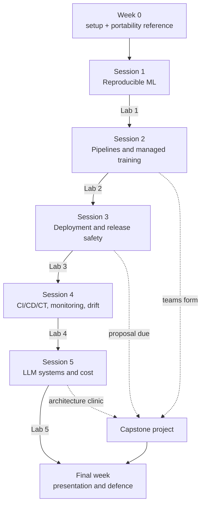

# ITCS355 — Course Materials

Everything a student needs to read, in one place. The code they run lives one level up, in
the repository root.

**ITCS355 Machine Learning Operation and Deployment** · 1(1-0-2) · Faculty of ICT, Mahidol
University · 5 sessions × 3 hours + final week

---

## How the course is organised

Each week has its own folder, and every folder has the same four parts — **Read**, **Prepare**,
**Do**, **Due**. Start from the [home page](../README.md), or go straight to
[Week 0](week-0-setup/).




---

## Session map

| Week | Topic | CLO | Lab | Code you touch |
|---|---|---|---|---|
| [0](week-0-setup/) | Set up your cloud account | — | — | `cloud.env`, `make cloud-check` |
| [1](week-1-reproducible-training/) | From Notebook to Reproducible ML | CLO1 | [Lab 1](week-1-reproducible-training/lab-01-reproducible-training.md) | `src/train.py`, `Dockerfile`, `tests/test_data.py` |
| [2](week-2-tracking-and-registry/) | Pipelines, features, and managed training | CLO1 | [Lab 2](week-2-tracking-and-registry/lab-02-tracking-and-registry.md) | `src/tune.py`, `src/costs.py`, `scripts/compare_runs.py` |
| [3](week-3-serving-and-rollback/) | Deployment, scaling, and release safety | CLO2, CLO3 | [Lab 3](week-3-serving-and-rollback/lab-03-serving-and-rollback.md) | `service/`, `loadtest/` |
| [4](week-4-cicd-monitoring-drift/) | CI/CD/CT, monitoring, and drift | CLO2, CLO3 | [Lab 4](week-4-cicd-monitoring-drift/lab-04-cicd-monitoring-drift.md) | `.github/workflows/`, `monitoring/` |
| [5](week-5-llm-systems-and-cost/) | Operating LLM systems and defending the bill | CLO2, CLO3 | [Lab 5](week-5-llm-systems-and-cost/lab-05-cloud-mlops-and-cost.md) | `pipeline/`, `cloudlayer/pipelines.py` |
| [Final](week-final-capstone/) | Presentations and defence | All | [Capstone brief](project/project-brief.md) | everything |

---

## Assessment at a glance

| Component | Marks | CLO1 / CLO2 / CLO3 |
|---|---|---|
| Capstone demo & defense | 15 | 5 / 5 / 5 |
| Capstone System | 30 | 10 / 10 / 10 |
| In-class drills (5 × 3) | 15 | 5 / 5 / 5 |
| Labs (5 × 8) | 40 | 15 / 15 / 10 |
| **Total** | **100** | **35 / 35 / 30** |

**There is no final examination.** The capstone is worth 45 across two lines: the five rubric
criteria score 30 as **Capstone System**, and the live demo and defence scores 15 as
**Capstone demo & defense**.

**Labs are marked directly**, 8 marks each, against the acceptance criteria in each handout.
A lab either meets them or it does not — there is no partial credit for a service that almost
deploys. At 40 marks the labs are the single largest component: this course is graded on what
you build and operate, not on what you can recall.

**In-class drills** run at the start of each session, 3 marks each. They carry evidence
questions drawn from your own lab output: your p95 figure, your run ID, the true cause behind
your drift alert. So a copied lab earns nothing in the drill. The labs also compound, which
means skipping Lab 1 makes Lab 3 impossible.

**Model accuracy is not graded anywhere.** A 0.71 AUC model with clean lineage, a working
rollback, and an honest cost report outscores a 0.94 model that only runs on its author's
laptop.

Full allocation is on the **Assessment Blueprint** sheet —
readable as [`spec/course-specification.md`](spec/course-specification.md), authoritative as
[`spec/Course_Specification_ITCS355_merged.xlsx`](spec/Course_Specification_ITCS355_merged.xlsx).

---

## Contents

```
course/
├── week-0-setup/                    the two setup guides — do one, not both
├── week-1-reproducible-training/    each week folder holds its README (Read, Prepare,
├── week-2-tracking-and-registry/    Do, Due), that session's slides, and that week's
├── week-3-serving-and-rollback/     lab handout
├── week-4-cicd-monitoring-drift/
├── week-5-llm-systems-and-cost/
├── week-final-capstone/
│
│   Used every week, so kept in one place:
├── project/      the capstone brief, milestones and rubric
├── reference/    the cloud portability contract
├── slides/       course-deck.md, the whole course on one page (also as styled HTML)
└── spec/         the faculty course specification. Course_Specification_691_ITCSB_ITCS355.xlsx
                  is the university's file, unmodified; *_merged.xlsx adds four course-design
                  sheets, and scripts/export_spec_md.py renders it as course-specification.md
```

---

## Cloud platform

The labs are written provider-neutral and work on **AWS, Azure, or GCP**. You pick one in
Week 0 and stay on it. Your choice does not affect your marks: the grader only ever calls
the neutral interface defined in the portability reference.

Target spend for the term is under 800 THB. Every lab ends with a teardown step, and
teardown is checked.
