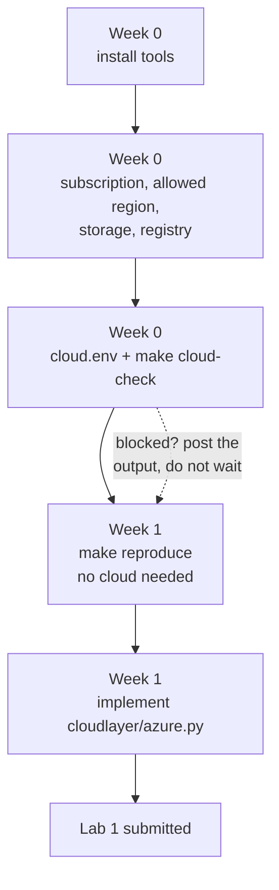

# ITCS355 — Getting Started on Azure (Week 0 and Week 1)

The Azure path through Week 0. Its sibling is
[`getting-started-gcp.md`](getting-started-gcp.md) — do **one** of them, not both, and stay on
the provider you pick for the whole term.

> **Read [`reference/cloud-portability-reference.md`](../reference/cloud-portability-reference.md)
> alongside this.** It explains *why* the repository is shaped the way it is. This guide is the
> *how*, in order, with the commands.

**Time:** about 90 minutes for Week 0, about 4 hours for Lab 1.



## Why you might pick Azure

**Azure for Students gives you credit without a credit card.** It verifies your academic status
from your university email and issues credit valid for twelve months. If you have no card, or
you would rather not put a personal card behind a course exercise, this is the path with the
fewest obstacles.

Three catches. The first two cost you an evening in Week 0 if nobody warns you; the third shapes
how you do Labs 2, 3 and 5.

**Your subscription can only deploy to a few regions, and the list is not the same for everyone.**
Azure for Students attaches a policy that limits each subscription to roughly five regions, chosen
per subscription. A region that works for your friend can refuse you. §3 shows how to find yours
before you create anything.

**Azure Container Registry bills a flat daily rate** — USD 0.1666 a day on the Basic tier, about
**42 THB a week**, whether you push anything or not. GCP's Artifact Registry charges for what you
store instead. Kept from Week 0 to the final week, the registry alone comes to roughly 300 THB —
a large share of the course's **800 THB target** before anything else has run. It comes out of
your student credit, not your pocket, but it is the biggest single line on an Azure bill in this
course. **Delete the registry when the course ends.** On Azure, teardown is not a formality.

## The vCPU ceiling — read this before Labs 2 and 3

**Azure for Students caps you at about 3 vCPU per region, and the cap cannot be raised.**

Free subscriptions are not eligible for quota increases. The request is refused by design, and the
only way past it is converting to Pay-As-You-Go, which means attaching a credit card — the exact
thing this path exists to avoid. Some student subscriptions show quota **0** for certain families,
D-series especially.

Three consequences you need to plan around:

| | |
|---|---|
| **VM sizes** | Use **B-series burstable**: `Standard_B1s` (1 vCPU) or `Standard_B2s` (2 vCPU). A 4-vCPU size such as `Standard_DS3_v2` will not deploy. |
| **Azure ML managed online endpoints** | Effectively unavailable. They reserve 20% for upgrades, so the quota needed is `ceil(1.2 x instances) x cores` — one `Standard_DS3_v2` instance asks for **8 vCPU** against a cap of 3. Even a 2-core size asks for 4. |
| **Low-priority Azure ML compute (Lab 2)** | Probably unavailable. Azure ML compute clusters have their **own** quota, separate from the VM quota, and low-priority cores are a single number across all VM families. On student subscriptions it can be **0**. |

### Lab 2's discounted compute on a student subscription

Lab 2 asks for trials on discounted compute. On Azure ML that means a `LowPriority` compute
cluster, and it draws on the low-priority line of the **Azure ML** quota. Check it before you design
your study around it:

```bash
az ml compute list-usage --resource-group $RG --workspace-name <workspace> -o table
```

If `TotalLowPriorityCores` shows a limit of 0, creating the cluster fails with
`ClusterMinNodesExceedCoreQuota` whatever VM size you pick, and the increase request is refused for
the same reason as above. Do not be misled by `az vm list-usage`: it may show a low-priority quota of
a few cores, but that is the **VM** quota, and it does not govern Azure ML compute clusters.

**The accepted substitution:** run the study on a `Dedicated` cluster sized to fit your dedicated
quota — small but non-zero, a few vCPU in the DSv2/Dv3 families — with min nodes 0 and max nodes 1,
and **demonstrate** the interruption instead of waiting for one.
Cancel a running trial part-way with `az ml job cancel`, then resume the study and show in your logs
that it picked up from the checkpoint. Resuming at the level of the study — completed trials are
skipped, the interrupted one restarts — is enough. Say in your README that you substituted, and
why, and commit the evidence with the lab. Dedicated nodes cost more per hour than low-priority
ones, so the 150 THB budget is tighter: keep the nodes small and the trials short, and record the
dedicated rate in your cost column, because that is the honest number.

Before you take the substitution, keep the `az ml compute list-usage` output. If
`TotalLowPriorityCores` is above zero on your subscription, use it — the lab's requirement stands.

### Lab 3 deploys to Container Apps

**So Lab 3 does not deploy to an Azure ML managed endpoint.** Deploy your container to **Azure
Container Apps** instead: consumption pricing, scales to zero, no Azure ML core quota involved, and
a monthly free grant that covers this course comfortably. The lab asks for a deployed inference
endpoint — it does not require it to be an Azure ML one.

**Create the environment yourself, and make sure it is not an Express environment.** Container Apps
now has an *Express* tier, and Express does not support multiple revisions or traffic splitting.
Lab 3 Task 4 is a 90/10 canary, which needs both. An app in an Express environment fails at
that step with `ExpressEnvironmentFeatureNotSupported`, after you have done everything else.

Microsoft's documentation says a new environment is a standard one unless you ask for Express, but
a student on Azure for Students got Express from a plain `az containerapp env create`, with or
without `--enable-workload-profiles`. Microsoft also migrates some existing environments to Express
automatically. So do not rely on the default: state the mode, then check it.

```bash
# --environment-mode is a preview parameter of the containerapp extension (1.3.0b4 or later)
az extension add --name containerapp --upgrade --allow-preview true
az provider register --namespace Microsoft.App --wait
az provider register --namespace Microsoft.OperationalInsights --wait

az containerapp env create --name itcs355-env --resource-group $RG --location $REGION \
  --environment-mode ConsumptionOnly --logs-destination none --tags course=itcs355

az containerapp env show --name itcs355-env --resource-group $RG \
  --query properties.environmentMode -o tsv        # must not print Express
```

`ConsumptionOnly` is the mode that has been confirmed to work on a student subscription. Microsoft
labels it legacy, but it has consumption pricing, scale to zero, and multiple-revision mode, which
is everything Lab 3 needs. `--logs-destination none` skips creating a Log Analytics workspace, which
bills per gigabyte; `az containerapp logs show` still streams your container's logs.

Then deploy into that environment by name. Without `--environment`, `az containerapp up` reuses or
creates an environment of its own choosing, which may not be this one:

```bash
az containerapp up --name itcs355-predict --resource-group $RG --environment itcs355-env \
  --image $ACR.azurecr.io/itcs355/serve:<sha> --target-port 8080 --ingress external \
  --registry-server $ACR.azurecr.io --registry-identity system
```

`--registry-identity system` is what lets the app pull from your **private** registry. It gives
the app a managed identity and grants that identity `AcrPull` on the registry, so nothing has to
store a registry password. Leave it off and the app is created but cannot start: the revision
fails with an `UNAUTHORIZED` image-pull error.

If you already deployed with a bare `az containerapp up`, check which kind of environment you got
(`az containerapp env show --name <env> --resource-group $RG --query properties.environmentMode`).
If it is Express, create `itcs355-env` as above and redeploy into it — an app cannot be switched to multiple-revision mode
while it lives in an Express environment. And if Azure emails you a notice that the environment
has been selected for automatic migration to Express, use the opt-out form in that notice before
Lab 3.

This is not a workaround to be embarrassed about. Choosing the service that fits your constraints,
and being able to say what the constraint was, is the whole subject.

---

## Before you start

| | What | How to check |
|---|---|---|
| 1 | Python 3.11 or newer | `python3 --version` |
| 2 | Docker, running | `docker run hello-world` |
| 3 | Git | `git --version` |
| 4 | An Azure subscription with credit | §2 below |

On Windows, use WSL2 and run everything in the Linux shell — the Makefile assumes bash.

---

# Week 0

## 1. Install the Azure CLI

```bash
curl -sL https://aka.ms/InstallAzureCLIDeb | sudo bash   # Debian / Ubuntu / WSL
brew install azure-cli                                    # macOS
az version
```

## 2. Get a subscription

Go to **https://azure.microsoft.com/free/students** and sign in **with your university email**.

Azure for Students verifies academic status from the address and issues credit with **no credit
card required**. If your university address is not recognised automatically, the sign-up offers
document-based verification instead — use it rather than switching to a personal address, because
the credit is tied to academic status.

**If verification fails**, stop and tell me. Do not fall back to a paid personal subscription.

Then:

```bash
az login
az account show
az account list --output table
```

`az account show` must print your subscription. If it prints nothing, the login did not complete.

```bash
export SUBSCRIPTION=$(az account show --query id -o tsv)
az account set --subscription "$SUBSCRIPTION"
```

## 3. Find your allowed regions, then create your resource group

**Do this before you choose a region.** Every Azure for Students subscription has a policy named
*Allowed resource deployment regions* that limits it to a short list — typically about five — and
**the list varies from student to student.** Create anything outside it and you get
`RequestDisallowedByAzure ... This policy maintains a set of best available regions`. You cannot
widen the list from your side, so read it:

```bash
az policy assignment list --disable-scope-strict-match \
  --query "[?displayName && (contains(displayName,'region') || contains(displayName,'ocation'))].{policy:displayName, parameters:parameters}" \
  -o json
```

Your allowed regions are in the `parameters` block of that output. If it prints `[]`, use the
portal: **Policy → Assignments → Allowed resource deployment regions → Parameters**.

Pick **Southeast Asia** (`southeastasia`, Singapore) **if it is on your list** — it is the closest
region to Bangkok and keeps Lab 3's latency numbers honest. If it is not, take the nearest one
that is — `eastasia` (Hong Kong), then `japaneast`, `koreacentral` or `centralindia` — and use that
**one region for everything**, all term. Post your region in the course channel, so a grader
reading your Lab 3 latency numbers knows where they came from.

Everything you create goes in one resource group, which is also how you delete everything later
in one command:

```bash
export REGION=<one region from your allowed list>
export RG=itcs355-<studentid>

az group create --name $RG --location $REGION \
  --tags course=itcs355 student=<studentid>
```

Those tags are not decoration. `make teardown` finds resources by tag from Lab 3 onward, and
Lab 5 grades whether teardown actually worked.

## 4. Create storage and a container registry

Storage account names are **globally unique, lowercase, 3–24 characters, letters and digits
only** — no hyphens. Registry names have the same rule. Put your student ID in both.

Register the two services first. A new subscription has most services switched off, and the
first create then fails with `MissingSubscriptionRegistration`. Registering is harmless to repeat,
and `--wait` returns only once it has finished:

```bash
az provider register --namespace Microsoft.Storage --wait
az provider register --namespace Microsoft.ContainerRegistry --wait
```

Later labs register their own: `Microsoft.MachineLearningServices` for Lab 2, and `Microsoft.App`
plus `Microsoft.OperationalInsights` for Lab 3's Container Apps (shown above).

```bash
export SA=itcs355<studentid>          # no hyphens, lowercase
export ACR=itcs355<studentid>

az storage account create --name $SA --resource-group $RG \
  --location $REGION --sku Standard_LRS --kind StorageV2 \
  --tags course=itcs355

az storage container-rm create --name itcs355 \
  --storage-account $SA --resource-group $RG

az acr create --name $ACR --resource-group $RG \
  --sku Basic --location $REGION --tags course=itcs355
```

`container-rm` creates the container through Azure Resource Manager, so owning the subscription
is enough. **An earlier version of this guide used `az storage container create --auth-mode
login` here, which is a data-plane call.** It needs the role you grant in §5, so in this order it
failed with `AuthorizationPermissionMismatch`. If that happened to you, nothing else is wrong —
run the `container-rm` line above and carry on.

Verify:

```bash
az storage account show --name $SA --query name -o tsv
az acr show --name $ACR --query loginServer -o tsv
```

## 5. Two separate logins — this trips up almost everyone

`az login` authenticates **you, at the terminal**. It does not authenticate **docker**, and the
Python SDK reaches your identity through a separate mechanism.

```bash
# so docker may push to your registry
az acr login --name $ACR
```

The Python side uses `DefaultAzureCredential`, which picks up your `az login` session locally and
a managed identity in CI. That is why the adapter uses it rather than a connection string — a
connection string is a secret you would then have to keep out of Git, and Lab 4 needs the CI path
to work anyway.

Give yourself data-plane access to the blobs. Owning the subscription is not the same as being
allowed to read the data inside it:

```bash
az role assignment create \
  --role "Storage Blob Data Contributor" \
  --assignee-object-id $(az ad signed-in-user show --query id -o tsv) \
  --assignee-principal-type User \
  --scope $(az storage account show --name $SA --resource-group $RG --query id -o tsv)
```

`--assignee-object-id` with `--assignee-principal-type User` skips a Microsoft Graph lookup that
can fail on a brand-new account. The Azure CLI documents the pair for exactly that reason.

Skipping the assignment produces `AuthorizationPermissionMismatch` on your first upload, which reads
like a code bug and is not one. **A role assignment also takes a few minutes to take effect**, so
an upload attempted straight afterwards can fail the same way. Wait five minutes and retry before
you start debugging your code.

## 6. Get the repository and write `cloud.env`

```bash
git clone <course-repo-url> && cd <repo>
cp cloud.env.example cloud.env
```

`cloud.env` holds your account identifiers. It is gitignored and **must stay that way** —
committing it is an automatic deduction on the capstone.

```bash
CLOUD_PROVIDER=azure
PROJECT_ID=itcs355-<studentid>
REGION=<the region you chose in §3>

BLOB_URI=https://itcs355<studentid>.blob.core.windows.net/itcs355/itcs355
CONTAINER_REGISTRY=itcs355<studentid>.azurecr.io/itcs355

MLFLOW_TRACKING_URI=sqlite:///mlflow.db

MODEL_REGISTRY_NAME=itcs355-<studentid>
IDENTITY_REF=<your az login account, from `az account show --query user.name -o tsv`>

BUDGET_LIMIT_THB=800
```

Two notes:

- **`BLOB_URI`** is `https://<account>.blob.core.windows.net/<container>/<prefix>`. The account
  and the container are different things and both appear in the URI; getting them the wrong way
  round is the classic first failure here.
- **`IDENTITY_REF` must not be empty.** `make cloud-check` fails any slot that resolves to an
  empty string, and all eight are required. In Lab 1 you run as yourself.

## 7. Verify

```bash
make setup          # installs pinned dependencies; ends with "environment ok"
make cloud-check    # eight capability slots plus CLI, credentials, docker
```

Every line should say PASS.

**Post this output in the course channel before Session 1** — even if lines say FAIL. That is
what it is for. A FAIL posted on Sunday is a five-minute problem; the same FAIL found in the room
is a lost session.

## 8. Know where to watch your credit — budgets do not work here

**Azure for Students cannot have a budget.** Microsoft lists the offer (`MS-AZR-0170P`) among those
**Cost Management does not support**, so `az consumption budget create` and the portal's
*Budgets* page both fail on your subscription. An earlier version of this guide told you to set a
budget here. If you tried and got an error, that is why; there is nothing to fix.

The protection comes from the offer itself. No card is attached, so when your credit runs out —
or twelve months pass, whichever comes first — Azure **disables the subscription** rather than
billing you. That stops the spending and it also stops your work: on Azure the risk is losing your
deployment the week before the capstone, not receiving an invoice.

So check the balance **once a week**, when you update your cost column:

- **https://www.microsoftazuresponsorships.com/balance** — sign in with the same account. It
  shows used and remaining credit and the expiry date, and its **Usage** page shows which service
  is spending it.
- Or search **Education** in the portal. The Education hub's Overview page shows your remaining
  credit too.

The term target is **under 800 THB**. Lab 1 costs almost nothing beyond the registry's 42 THB a
week. The expensive mistakes come later, and they always come from something left running.

Everything you made lives in one resource group, so the end-of-term cleanup is one command:

```bash
az group delete --name $RG --yes          # deletes storage, registry, everything
```

**Do this when the course ends.** The registry bills daily whether you use it or not.

---

# Week 1 — Lab 1

Full handout: [`../week-1-reproducible-training/lab-01-reproducible-training.md`](../week-1-reproducible-training/lab-01-reproducible-training.md).

## The part that needs no cloud at all

This is deliberate, and it is the point of the lab. `make reproduce` runs entirely on your
machine, in Docker, with no credentials. That is exactly why a grader can run it.

```bash
make data        # generate the dataset, deterministically
make test        # data contract and split property tests
make train       # train locally, outside the container
make reproduce   # THE ONE COMMAND — the grader runs this and nothing else
make verify      # compare the produced metric against the claim in README.md
```

**If you are stuck on Azure access, do this part anyway.** It is most of the lab, and it is the
half graded by a script.

### On Apple Silicon

`make image` builds for `linux/amd64` so the image matches CI and the grader. Under emulation
that is slow — several minutes is normal, not a hang.

## The Azure part

Lab 1 asks you to implement three of the eleven adapter methods in
[`cloudlayer/azure.py`](../../cloudlayer/azure.py): `upload`, `download`, and `push_image`.

```bash
pip install azure-storage-blob azure-identity
```

The file's docstring carries the specific hints. The rules that matter:

- **Parse the blob URI inside the adapter, never in `src/`.** `make portability-audit` fails the
  build if `blob.core.windows.net`, `abfss://`, or an Azure SDK import appears in `src/`,
  `service/`, `monitoring/`, or `tests/`. That is Layer 1, and it stays provider-neutral.
- **Use `DefaultAzureCredential`, not a connection string.** A connection string is a secret in
  your environment; the credential chain is not, and it is what makes Lab 4's CI path work.
- **`push_image` must return the digest reference**, `registry.azurecr.io/repo@sha256:...`, not
  the tag. A tag can be moved to point at different bytes; a digest cannot. During an incident,
  "which code is serving?" has to have one answer.
- **Azure tags live on the resource, not the blob.** Tag the storage account and the registry
  with `cfg.tags(1)` — you did this at creation time in §3 and §4.

Check your work:

```bash
make portability-audit
make image
make image-push
```

## Common failures, in the order you will hit them

| Symptom | Cause |
|---|---|
| `RequestDisallowedByAzure` … *best available regions* | Your subscription's allowed-regions policy (§3). Use a region from **your** list; the list cannot be widened |
| `MissingSubscriptionRegistration` | That service's provider is not registered yet — `az provider register --namespace <the namespace in the error> --wait` (§4) |
| `AuthorizationPermissionMismatch` on `az storage container create` | A data-plane command run before the role exists. Use `az storage container-rm create` (§4) |
| `AuthorizationPermissionMismatch` on upload | No **Storage Blob Data Contributor** role — owning the subscription is not data-plane access (§5) |
| Upload still fails just after you added the role | Role assignments take a few minutes to take effect. Wait and retry before debugging |
| Budget creation fails, or Cost Management says it is unavailable | Budgets are not supported on Azure for Students (§8). Watch the balance page instead |
| Container App created but never starts; image pull `UNAUTHORIZED` | Deployed without `--registry-identity system`, so it cannot pull from your private registry |
| `unauthorized: authentication required` on push | You skipped `az acr login` (§5) |
| Storage account create fails, name invalid | Names are lowercase alphanumeric, 3–24 chars, **no hyphens** |
| Storage account create fails, name taken | Names are globally unique — add your student ID |
| `make cloud-check` fails on `credentials` | `az account show` returns nothing; re-run `az login` |
| `make cloud-check` fails on one slot reading `unset` | All eight slots must be non-empty, `IDENTITY_REF` included |
| Container and account swapped in `BLOB_URI` | The account is the hostname; the container is the first path segment |
| Portability audit fails after your adapter works | You put URI parsing in `src/` instead of `cloudlayer/` |
| Credit draining with nothing running | ACR Basic bills daily regardless of use — that is expected, and why teardown matters |

---

## What to have done before Session 2

- [ ] `make cloud-check` all green, output posted in the course channel
- [ ] Your allowed regions checked, and your one region posted in the course channel
- [ ] The credit balance page bookmarked (§8)
- [ ] `make reproduce` works from a **fresh clone**, not just your working directory
- [ ] The `expected test_roc_auc:` line in the root `README.md` re-measured and updated
- [ ] `cloudlayer/azure.py` implements `upload`, `download`, `push_image`
- [ ] `make portability-audit` passes
- [ ] `cloud.env` is **not** in `git status`

Lab 1 is worth 8 marks, awarded met-or-not-met: `make reproduce` works from a fresh clone on a
machine that is not yours, and the metric matches your claim. There is no partial credit for a
repository that almost reproduces — which sounds harsh and is kinder in practice, because it is
the same unambiguous standard for everyone.
